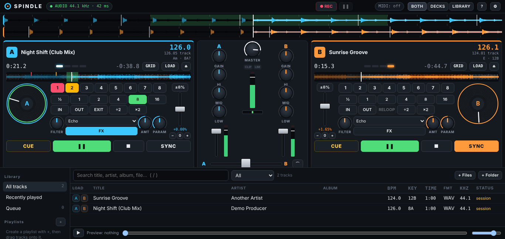

# Spindle DJ

**Created by David Blackwood** · [User guide](docs/USER_GUIDE.md) · [Download](../../releases/latest) · [Report a bug](../../issues)

**A free, open-source two-deck DJ mixer that runs in Chrome or Edge on a Chromebook, on Windows, on Linux, or anywhere else Chrome runs.**
Real audio playback, mixing, beat-sync, cue points, loops, EQ, effects, recording, a music library and MIDI controller support. No account, no telemetry, no uploads: your music never leaves your device.



> Licensed **GPL-3.0-or-later**. Inspired by the general workflow of desktop DJ software; all code, design and branding are original. Not affiliated with VirtualDJ, Atomix, Pioneer DJ or AlphaTheta.

---

## Use it now (no install)

**▶ https://mjpredator403-ship-it.github.io/spindle-dj/** opens the app in Chrome or Edge. Click **Install** in the address bar to get a desktop or launcher icon that also works offline.

## Download

Grab the latest files from **[Releases](../../releases/latest)**:

| File | For |
|---|---|
| `spindle-dj-<version>.zip` | Source code plus the ready-built app, for any computer with Python 3 (`./run.sh`) |
| `spindle-dj_<version>_all.deb` | Debian, Ubuntu, Mint, ChromeOS Linux: `sudo apt install ./spindle-dj_*_all.deb` |

New to DJing or to Spindle? Read the **[User Guide](docs/USER_GUIDE.md)**.

## Quick start

### On a Chromebook (recommended path)

The app runs **in ChromeOS's own Chrome**, which gives the best audio latency, direct access to your music, and USB MIDI controllers. The Linux container is only used to serve the files on `http://localhost`.

1. Turn on Linux: **Settings → About ChromeOS → Developers → Linux development environment → Set up**.
2. Copy `spindle-dj-0.1.0.zip` into **Linux files** in the Files app, then open the **Terminal** app and run:
   ```bash
   unzip spindle-dj-0.1.0.zip && cd spindle-dj
   ./run.sh
   ```
3. Open **http://localhost:8765/** in Chrome. Click **Start audio**.
4. Optional: Chrome menu → **Cast, save and share → Install page as app** to get a Spindle window and launcher icon that works offline.

The prebuilt app is included, so this needs only Python 3 (already in the Linux container). Full walkthrough, including music-folder access and audio troubleshooting: **[docs/CHROMEOS.md](docs/CHROMEOS.md)**.

### On Debian / Ubuntu (or Crostini) as a package

```bash
sudo apt install ./spindle-dj_0.1.0_all.deb
spindle-dj            # or launch "Spindle DJ" from the app menu
```

### From source (developers)

Requires **Node.js ≥ 20.19** (see `docs/CHROMEOS.md` for installing it with nvm on a Chromebook).

```bash
npm ci
npm run dev          # one-command hot-reload dev server → http://localhost:5173/
npm test             # unit tests (Node)
npm run test:e2e     # builds, then runs the browser acceptance tests in headless Chrome
npm run build        # production build → dist/
npm run serve        # serve dist/ on http://localhost:4173/
npm run package:deb  # → release/spindle-dj_<version>_all.deb
```

> Opening `dist/index.html` directly from disk (`file://`) **will not work**: browsers only allow AudioWorklet, Web MIDI and file access in a *secure context* (`https://` or `http://localhost`).

---

## Features

| Area | What you get |
|---|---|
| **Decks** | Two independent decks: play/pause, stop-to-start, CDJ-style CUE (set while stopped, hold to preview, jump-back-and-stop while playing), 8 hot cues, title/artist/time elapsed & remaining, scrolling + overview waveforms (click/drag to seek), jog wheel (nudge while playing, scrub while paused), pitch fader ±8/16/50 %, nudge buttons, tap tempo, load/eject |
| **Analysis** | BPM and beat grid from the real audio (worker thread, cached), confidence shown, “~” for uncertain; musical key (Camelot + standard) as an estimate; manual grid correction (½×, 2×, shift ±10 ms, beat-here, tap) |
| **Sync** | Tempo match (handles half/double time) + beat-phase alignment, sync-lock that follows the other deck's pitch, phase meter |
| **Loops** | ½ – 16 beat loops quantised to the grid, manual loop in/out, exit/reloop, halve/double |
| **Mixer** | Per channel gain/trim, 3-band **isolator EQ** (Linkwitz–Riley crossovers, true kills), channel fader, peak meters with clip LEDs; equal-power or sharp crossfader; master volume; look-ahead **limiter** (−1 dBFS ceiling) with LIMIT/CLIP indicators |
| **Effects** | Per deck: bipolar low-/high-pass filter; echo (beat-synced), reverb, flanger with amount + parameter |
| **Recording** | Records the master output to 16-bit WAV — streamed straight to a file you choose (bounded memory), or downloaded |
| **Library** | Import files or whole folders (only what you pick), drag files from the Files app, search, sort, filter, playlists, queue, recently played, missing-file detection and relink (single file or a whole folder), persistent storage, preview player with separate output device (headphone pre-listen) |
| **Control** | Configurable keyboard shortcuts; Web MIDI with MIDI-learn, import/export of mappings |
| **App** | Installable PWA, works offline, dark theme, keyboard-navigable, screen-reader labels, compact layout for small screens |

### Honest limitations (v0.1)

* **No key-lock**: tempo changes are vinyl-style (pitch moves with tempo). Pitch-preserving time-stretch is on the [roadmap](docs/ROADMAP.md).
* **No split headphone cue (PFL) of the decks.** Browsers expose stereo output only; the library *preview* can go to a second device instead.
* **Latency depends on the Chromebook and output device** (Spindle shows the browser-reported value in the top bar and Settings → Audio). It is aimed at mixing, not turntablism-grade scratching. Bluetooth output adds noticeable delay.
* **Whole tracks are decoded into RAM** (~21–23 MB per stereo minute). A 30-minute cap protects 4 GB devices (adjustable).
* Key detection is an estimate and can be wrong on complex material.

## Credits and license

Spindle DJ was **created by David Blackwood**, its original author. It is free software under the **GNU GPL v3.0 or later**: anyone may use, study, share and modify it. The one condition added under GPL section 7(b) is that **forks and modified versions keep the credit “Created by David Blackwood”** in their About screen and keep the source-file headers. Details are in [NOTICE](NOTICE). Contributors are listed in [AUTHORS.md](AUTHORS.md). To cite the project, use GitHub's **“Cite this repository”** button.

## Contributing

Ideas, bug reports and pull requests are welcome. Read [CONTRIBUTING.md](CONTRIBUTING.md), then fork the repository, make your change on a branch, run `npm test` and `npm run test:e2e`, and open a pull request. Good first projects are listed in [docs/ROADMAP.md](docs/ROADMAP.md), such as key-lock, more effects, and controller mappings.

## Documentation

* [docs/USER_GUIDE.md](docs/USER_GUIDE.md): how to install, mix, record and map a controller
* [docs/ARCHITECTURE.md](docs/ARCHITECTURE.md) — feasibility assessment, native vs browser comparison, chosen architecture, audio graph, risks
* [docs/CHROMEOS.md](docs/CHROMEOS.md) — step-by-step Chromebook setup and audio diagnosis
* [docs/TESTING.md](docs/TESTING.md) — automated tests, latest results, manual test plan, what is not verified
* [docs/TROUBLESHOOTING.md](docs/TROUBLESHOOTING.md) · [docs/ROADMAP.md](docs/ROADMAP.md)
* [PRIVACY.md](PRIVACY.md) · [SECURITY.md](SECURITY.md) · [CONTRIBUTING.md](CONTRIBUTING.md) · [THIRD_PARTY_NOTICES.md](THIRD_PARTY_NOTICES.md)

## Default keyboard shortcuts

| Deck A | Deck B | Action |
|---|---|---|
| Z | M | Play / pause |
| X | N | Cue (hold) |
| C | B | Sync |
| V | , | 4-beat loop |
| A / S | K / L | Nudge slower / faster (hold) |
| 1 – 4 | 7 – 0 | Hot cues 1 – 4 |

← / → crossfader · ↓ centre · R record · / search. All remappable in Settings → Keyboard.
